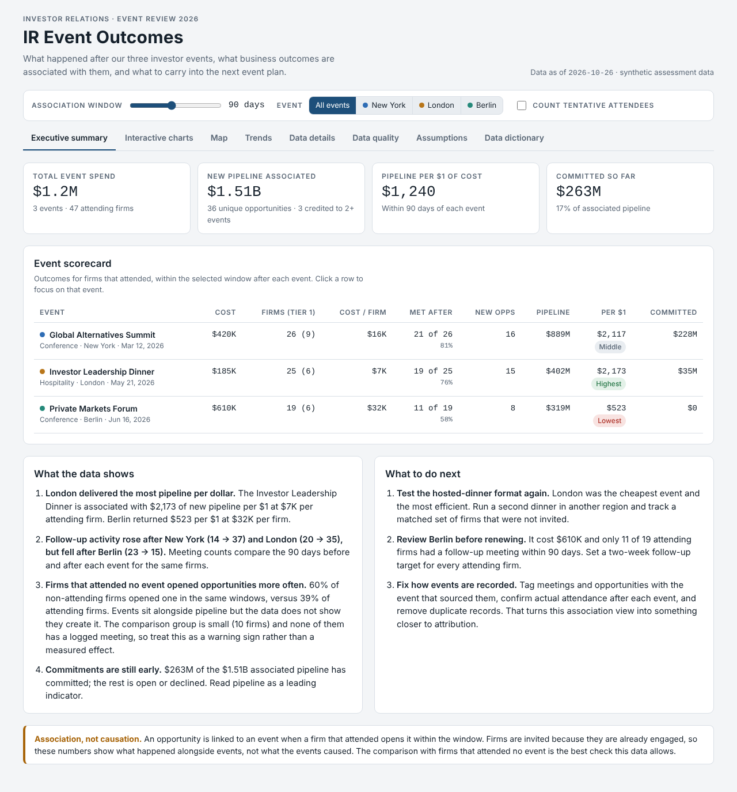

# IR Event Outcomes

An interactive analysis of three 2026 investor events. It answers the assessment question: **what happened after our investor events, what business outcomes are associated with them, and what should we learn for future events?**

**Live dashboard:** https://nishit-io.github.io/ir-event-outcomes/



## Executive readout

For the five-minute conversation with the Head of IR:
- **[`readout/IR_Event_Readout.pdf`](readout/IR_Event_Readout.pdf)**: one page. GitHub shows it directly in the browser.
- **[`readout/IR_Event_Readout.pptx`](readout/IR_Event_Readout.pptx)**: three slides with speaker notes. The charts are native PowerPoint charts, so they can be edited.

Both are generated by `readout/build_readout.py` from the same model as the dashboard, at its default settings (90-day window, Confirmed attendees). Every number therefore matches the dashboard, and the wording is written from the numbers. The build checks that the PDF is exactly one page and the deck exactly three slides, and that the key figures in both match the model.

## How to view it

| Option | What to do |
|---|---|
| **Open the file** | Download the repo and double-click `out/ir_event_outcomes.html`. It opens in any modern browser and works offline. The data, chart library and map library are all built into the file. |
| **Live link** | **[nishit-io.github.io/ir-event-outcomes](https://nishit-io.github.io/ir-event-outcomes/)**. The same dashboard, served by GitHub Pages from `docs/`. To host a copy (for a fork, say): **Settings → Pages → Deploy from a branch → `main` / `docs` → Save**. |
| **Just look** | Screenshots of every tab are in [`screenshots/`](screenshots). GitHub shows `.html` files as source code, so the screenshots are the quickest way to see the dashboard without downloading it. |

**Exploring it.** The slider, event buttons and Tentative toggle at the top recalculate every tab. Clicking any bar or line on the *Interactive charts* or *Trends* tab filters the whole dashboard to what it represents: an event, a status, an investor group, a funnel step, a firm, the firms active in a month, the firms that had a certain kind of meeting, or the firms with no follow-up. Active filters show as chips. Remove one with ×, or reset everything with **Clear all**.

The map uses OpenStreetMap tiles when they can load (local file with internet, or GitHub Pages). Without them it switches automatically to a built-in country outline. The pins, region bubbles and figures are the same either way.

## How to rebuild it

```bash
pip install -r requirements.txt
playwright install chromium      # once, for the checks
python run_all_checks.py         # rebuild everything and run every check
```

`run_all_checks.py` runs, in order, and stops at the first failure:
0. `pytest`: 146 unit and integration tests on **synthetic** data (see *Testing*).
1. `build_model.py`: cleans the CSVs and computes the KPIs into `out/model.json`.
2. `build_dashboard.py`: builds the single standalone HTML file. **The build fails if anything the page needs would load from the internet.** Only Google Fonts and the OpenStreetMap tiles may, and the page has fallbacks for both.
3. `test_standalone.py`: copies *only* the HTML file into an empty folder, opens it with all internet access blocked, and checks every tab.
4. `verify_dashboard.py`: checks the dashboard's numbers match the Python numbers at 6 settings, and refreshes `screenshots/`.
5. `test_crossfilter.py`: clicks every chart and checks the filter each click sets, the resulting numbers, and that no chart goes blank.

6. `readout/build_readout.py`: rebuilds the executive readout PDF and deck. It needs Node with the packages in `readout/package.json` (`cd readout && npm install`).

`build_model.py --window 60 --include-tentative` prints the KPIs for other settings. `--data DIR` and `--out DIR` point it at another folder of CSVs.

## Input data rules

`build_model.py` validates the five CSVs before using them:

- **Problems that stop the build** produce one message naming the file, column and CSV row, with no traceback, and exit code 2:
  - a missing file or column
  - a duplicate or empty ID in `events`, `firms` or `meetings`
  - a date that can't be read
  - a non-numeric amount, or a negative event cost or historical commitment
  - a file that isn't UTF-8
- **Problems that only affect a row** set that row aside. It is logged as a data-quality rule on the **Data Quality** tab, and the build continues:

| Rule | What is set aside |
|---|---|
| DQ12 | Opportunities with a missing, zero or negative amount (the whole opportunity) |
| DQ13 | Stage rows with an unknown stage name |
| DQ14 | Attendance rows with a status other than Confirmed/Tentative |
| DQ15 | Rows that point to a firm or event that doesn't exist |

- Dates with a timezone are converted to UTC calendar dates. The dashboard also calculates in UTC, so every viewer sees the same numbers wherever they are.
- An event that cost $0 shows "n/a" for pipeline per $1 instead of an infinite ratio.
- Labels, colours, map positions, regions, the Trends months and the firm timeline all come from the data, so a new event list or region works without code changes. A city or region the map doesn't know is listed under the map instead of breaking it.

## Testing

```bash
pytest                    # 146 tests, about 1 minute; needs `playwright install chromium` for the dashboard tests
```

| File | What it covers |
|---|---|
| `tests/test_model.py` | Loading and validation errors, each cleaning rule, opportunity status, window boundaries (event day, day 1, last day, day after), the as-of date, multi-event credit, zero cost, no events, Unicode, the command line, and a 6,000-opportunity speed test |
| `tests/test_dashboard.py` | The page's own JavaScript, run in headless Chromium through a read-only `window.__irTest` hook. Covers formatters, browser calculations matching Python, identical results in 3 timezones, every cross-filter, saved-settings validation, data-driven labels, regions and months, unusual data, and security |
| `tests/test_readout.py` | Readout formatting matches the dashboard (half-up rounding), wording built from the facts, theme writer |
| `tests/test_build_dashboard.py` | The standalone guarantee, data that can't break out of its script block, and clear errors for a missing or bad `model.json` |

All test data is synthetic and built inside the tests (`tests/conftest.py`). The browser-level scripts (`test_standalone.py`, `verify_dashboard.py`, `test_crossfilter.py`) run against the project's own data.

**Security.** Every data value written into the page as HTML is escaped. A test fills every text field with script-injection payloads and confirms nothing runs. IDs such as `__proto__` or `constructor` are handled safely. The page makes no network requests except the optional fonts and map tiles. It has no login, forms or server, so CSRF, SQL injection and access control don't apply.

## Repository layout

```
data/                     the five source CSVs, unchanged
build_model.py            cleaning rules, opportunity model, attribution, KPIs, raw-vs-clean impact
build_dashboard.py        injects the model and libraries into the template
dashboard_template.html   the dashboard: layout, styles and all in-browser calculations
run_all_checks.py         pytest + rebuild + every browser check, in one command
tests/                    pytest suite (synthetic data): model, dashboard JavaScript, build
pytest.ini                pytest settings
test_standalone.py        the HTML file alone, offline, every tab
verify_dashboard.py       parity test (Python vs dashboard) and screenshot capture
test_crossfilter.py       clicks every chart, checks filters and numbers
vendor/                   Chart.js 4.4.1, Leaflet 1.9.4 (both MIT), world outline from world-atlas (ISC)
out/                      built dashboard + model.json
docs/index.html           copy of the dashboard for GitHub Pages
screenshots/              one image per tab
readout/                  executive readout: 1-page PDF, 3-slide deck, their generator and IBM Plex fonts (OFL)
AI_USAGE.md               how AI was used, checked and corrected
CHANGELOG.md              what changed, by version
```

## Approach

### Data model

Firms are the hub. Attendance links firms to events. Meetings and opportunities belong to firms and are linked to an event **by date**: an outcome counts for an event when it happens inside a window after the event and the firm attended.

- `opportunity_stage_history` (one row per stage change) is collapsed into one row per **opportunity**. That row holds the amount, created date, furthest stage, current status (Open, Committed or Declined), and the dates it reached Due Diligence and Committed.
- All event KPIs are recalculated in the browser when the window, event filter, Tentative setting or a cross-filter changes. `build_model.py` holds the same logic in Python. `verify_dashboard.py` checks the two match on the real data at six settings, and `tests/test_dashboard.py` checks them on synthetic data at eight.

### Key decisions (agreed up front)

| Decision | Choice | Why |
|---|---|---|
| Association window | Adjustable 15–180 days, default **90** | 90 days is fully observed for all three events. The slider shows whether conclusions depend on the choice. |
| Firm attended more than one event | Each event gets full credit; portfolio totals count each opportunity once | Avoids an arbitrary first- or last-touch rule without inflating totals. 3 opportunities are double-credited at 90 days. |
| Tentative attendees | Excluded by default; a toggle includes them | The data can't confirm Tentative contacts came. The toggle shows how sensitive the results are. |
| Baselines | Attendees vs firms at no event, and the same firms before vs after | Separates "happened after the event" from "would have happened anyway" as far as this data allows. |
| Headline KPI | **Pipeline created per $1 of event cost**, with a funnel and status split | Commitments are too few and too early to rank events on. Declined pipeline is counted as created and shown separately. |
| Data quality | Clean by documented rules and show their impact | Every rule is listed in the Data Quality tab with rows affected and the KPI change. |

Full metric definitions and assumptions are in the dashboard's **Assumptions** tab. Column meanings are in the **Data dictionary** tab.

### Data quality, in short

11 issues were logged. The ones that change numbers:
- **O9999** duplicates **O9998**, which also has no stage history before Committed. Removing it takes $25M off London's pipeline and committed totals.
- Two stage dates fall after the as-of date of 26 Oct 2026 (O0037 Committed, O0072 IC). They are treated as not yet happened.
- Attendance row A0011 is duplicated, and A9998 has no firm.
- Repeated stage entries (12 rows) are collapsed, and F028 is flagged as a possible duplicate of F008.
- **None of the 10 firms at no event has a logged meeting**, yet they opened 24 opportunities. Meeting logging looks incomplete outside events, which weakens the attendee vs non-attendee comparison.

## Key findings in brief

All figures use the default 90-day window and Confirmed attendees.

1. **$1.2M of event spend sits alongside $1.51B of new pipeline.** That is 36 opportunities opened by attending firms within 90 days. $263M (17%) has committed; most of the rest is still open.
2. **The London dinner was the most efficient event; the Berlin forum the least.**
   - London cost $185K, $7K per attending firm, and returned $2,173 of pipeline per $1.
   - Berlin cost $610K, $32K per firm, and returned $523 per $1. Meetings with Berlin attendees *fell* after the event (23 → 15), and 42% of its firms had no follow-up meeting within 90 days.
3. **We can't say the events caused the pipeline.** Firms that attended no event opened opportunities at a *higher* rate (50–70%) than attendees (32–42%) over the same windows. Those firms also have no logged meetings, so the comparison is a warning sign, not a measurement.
4. **New York's pipeline keeps climbing at windows past about 105 days.** London's and Berlin's flatten after about 60. Some of New York's long-window pipeline is probably unrelated to the event.
5. **Actions:**
   - Run a second hosted dinner in another region, with a matched set of uninvited firms to compare against.
   - Review Berlin before renewing, and set a two-week follow-up target for every attending firm.
   - Tag meetings and opportunities with the event that sourced them, confirm actual attendance, and remove duplicates, so the next review can measure attribution instead of association.

## Limitations

- Three events is a very small sample. Differences between events are directional, not statistically tested.
- Event cost excludes staff time and travel, which aren't in the data.
- Firms have only a coverage region, so the map places firms at approximate region centres.
- The data is synthetic and was created for this assessment.
